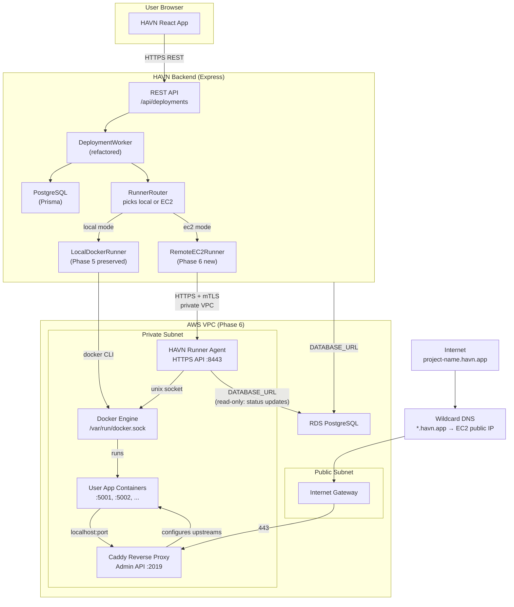
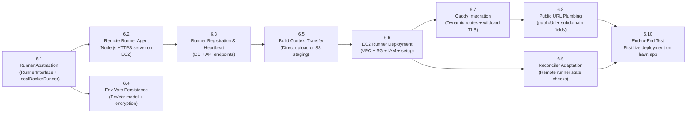

# HAVN Phase 6: Remote Deployment Runner Architecture

**Document Type:** Architecture Design & Audit  
**Status:** Draft — Awaiting Approval Before Implementation  
**Author:** Senior Cloud Architect / DevOps Review  
**Base Commit:** `7be5d4f` (develop)  
**Date:** 2026-11-23

> [!IMPORTANT]
> This is a **design document only**. No implementation, schema migrations, AWS provisioning, or production changes have been made. No Phase 5 code has been modified.

---

## Table of Contents

1. [Existing Architecture Audit](#1-existing-architecture-audit)
2. [Current System Limitations](#2-current-system-limitations)
3. [Proposed Phase 6 Architecture](#3-proposed-phase-6-architecture)
4. [Architecture Diagram](#4-architecture-diagram)
5. [Deployment Execution Flow](#5-deployment-execution-flow)
6. [Runner Communication Protocol](#6-runner-communication-protocol)
7. [AWS Infrastructure Design](#7-aws-infrastructure-design)
8. [Caddy and Domain Routing Design](#8-caddy-and-domain-routing-design)
9. [Proposed Database Changes](#9-proposed-database-changes)
10. [Security Considerations](#10-security-considerations)
11. [Failure Handling and Recovery](#11-failure-handling-and-recovery)
12. [Cost Considerations](#12-cost-considerations)
13. [Phase 6 Implementation Roadmap](#13-phase-6-implementation-roadmap)
14. [Acceptance Criteria](#14-acceptance-criteria)
15. [Assumptions Requiring Confirmation](#15-assumptions-requiring-confirmation)

---

## 1. Existing Architecture Audit

### 1.1 Backend Structure

```
backend/src/
├── server.ts                 # Express entry point; starts DeploymentWorker singleton
├── app.ts                    # Express app; CORS, security headers, routes
├── routes/                   # Route definitions (auth, project, deployment, github, health)
├── controllers/              # HTTP handler layer (deployment.controller.ts is the richest)
├── services/
│   ├── deployment.worker.ts  # DB-backed async worker; heartbeats; reconciler; crash recovery
│   ├── docker.service.ts     # All Docker CLI orchestration (build/run/stop/inspect/logs)
│   ├── deployment.service.ts # Workspace preparation; git clone; Dockerfile validation
│   ├── project.service.ts    # Project CRUD; live/latest deployment resolution
│   ├── git.service.ts        # Secure clone; path traversal; GIT_ASKPASS injection
│   └── ai*.ts                # AI diagnostics (Gemini, scope guard, cache)
├── utils/                    # crypto.ts, jwt.ts, sanitizer.ts
└── constants/build.constants.ts
```

### 1.2 Deployment Pipeline (Phase 5 — Verified)

The Phase 5 pipeline is a fully implemented local Docker deployment system:

```
[User Request] → createDeployment (Controller)
    → Prisma transaction (FOR UPDATE row lock) — atomically creates QUEUED record
    → deploymentWorker.notify()

DeploymentWorker (singleton, in-process):
    → processNext() — claims QUEUED via UPDATE WHERE status=QUEUED + workerId + heartbeatAt
    → prepareDeploymentWorkspace() — git clone, Dockerfile validation, imageTag generation
    → executeDockerBuild() — docker buildx build CLI, log streaming → PostgreSQL BuildLog
    → executeStartupAndPromotion()
        → startApplicationContainer() — docker run with resource limits, label tagging
        → probeApplicationReadiness() — HTTP probe loop on host-mapped port
        → promoteDeployment() — atomic RUNNING promotion + Project.liveDeploymentId update
    → reconcileRunningDeployments() — 15s interval; docker inspect → CRASHED if container gone
    → recoverStaleDeployments() — 60s interval; reclaims timed-out BUILDING/STARTING records
```

### 1.3 Key Abstractions Identified

**What exists as a single coupled unit (`docker.service.ts`):**

| Function | Description |
|---|---|
| `verifyDockerDaemon()` | Checks Docker socket connectivity |
| `executeDockerBuild()` | Runs `docker buildx build` subprocess |
| `startApplicationContainer()` | Runs `docker run` with ports, limits, labels |
| `probeApplicationReadiness()` | HTTP health probe on `localhost:hostPort` |
| `inspectContainerState()` | `docker inspect` for running/exited/crashed |
| `stopDockerContainer()` | `docker stop` + `docker rm -f` |
| `getContainerRuntimeLogs()` | `docker logs --tail` |
| `cleanupProjectContainers()` | `docker ps --filter label=...` + stop all |
| `deleteDockerImage()` | `docker rmi` |
| `inspectImageExposedPort()` | Reads `EXPOSE` from image inspect |
| `inspectDockerImageSize()` | Reads image size in bytes |

**What the `DeploymentWorker` owns:**
- PostgreSQL-backed queue claiming (`FOR UPDATE SKIP LOCKED` equivalent via `updateMany`)
- Worker leases (`workerId`, `heartbeatAt`) with 30/120s stale thresholds
- `SystemLock` table for distributed reconciler coordination
- Abort signal propagation for cancellation

### 1.4 Prisma Schema Summary

```
User → Project (1:N) → Deployment (1:N) → BuildLog (1:N)

Project:
  - liveDeploymentId: String?       ← FK-like pointer to live Deployment

Deployment:
  - workerId: String?               ← which worker claimed this job
  - heartbeatAt: DateTime?          ← lease freshness
  - imageTag: String?               ← cloudforge/deployment-<id>:<sha>
  - containerId: String?            ← Docker container ID
  - hostPort: Int?                  ← ephemeral port on local host
  - internalPort: Int? @default(3000)
  - localUrl: String?               ← http://localhost:<hostPort>
  - status: DeploymentStatus enum

SystemLock:
  - key: String @id
  - holder: String
  - acquiredAt / expiresAt / updatedAt
```

**Notable absences in schema (Phase 5 boundary):**
- No `Runner` model
- No `DeploymentJob` model
- No public URL / domain fields
- No runner assignment on Deployment
- No runner heartbeat tracking

### 1.5 Infrastructure Audit

**No existing AWS infrastructure found.**  
No `terraform/`, `cloudformation/`, `cdk/`, `ansible/`, or `.aws/` directories exist in the repository. No `Caddyfile`, `docker-compose.yml`, or Nginx configuration exists. No `Dockerfile` for the backend application itself exists.

**Current networking assumptions (local):**
- Docker socket: `/var/run/docker.sock` (or Windows named pipe) on dev machine
- Ports: ephemeral host ports (`:4000`–`:9000` range typical)
- URLs: `http://localhost:<port>` — only accessible on the dev machine

**Configured backend env vars (`backend/.env.example`):**
```
DATABASE_URL        PostgreSQL connection string
PORT                Express server port (default 5000)
JWT_SECRET
JWT_EXPIRES_IN
NODE_ENV
GEMINI_API_KEY
GEMINI_MODEL
```

**Absent (Phase 6 will require):**
```
FRONTEND_URL        (exists in app.ts CORS logic, absent from .env.example)
TRUST_PROXY         (exists in app.ts, absent from .env.example)
RUNNER_API_KEY      (new — backend→runner auth)
AWS_REGION          (new)
CADDY_ADMIN_URL     (new — dynamic upstreams)
PUBLIC_DOMAIN       (new — e.g. havn.app)
```

---

## 2. Current System Limitations

| # | Limitation | Impact |
|---|---|---|
| L1 | `docker.service.ts` calls `docker` CLI via `child_process.spawn` on the **same machine** as the backend. The Docker socket is local only. | Cannot delegate execution to a remote EC2 host without architectural change. |
| L2 | `localUrl` stores `http://localhost:<port>` — only valid on the dev machine. | No public internet accessibility. This is not a live production URL. |
| L3 | `hostPort` is an ephemeral OS-assigned port. No wildcard DNS, no reverse proxy, no TLS. | Cannot serve external traffic. |
| L4 | `DeploymentWorker` is a singleton, in-process, single-concurrency. | Cannot distribute jobs across multiple EC2 runner instances. |
| L5 | Build artifacts (images, workspaces) exist only on the local machine's filesystem and Docker daemon. | EC2 runners have isolated filesystems — a build on one host cannot directly use an image on another. |
| L6 | No `Runner` registry — no concept of registered remote runners in the database. | Cannot route jobs, track runner health, or implement failover. |
| L7 | Reconciler uses `docker inspect` via local CLI — only reconciles containers on the local machine. | A remote runner's containers are invisible to the HAVN backend reconciler. |
| L8 | No Caddy, no wildcard DNS, no TLS. | No `project-name.havn.app` URLs possible. |
| L9 | Environment variables for deployed apps are not persisted in the database (React state only). | Cannot pass user-defined env vars to remote runner containers. |
| L10 | No backend `Dockerfile` — the backend cannot be containerized or deployed to EC2 without one. | Infrastructure deployment of the backend itself requires this. |

---

## 3. Proposed Phase 6 Architecture

### 3.1 Core Design Principle

**Runner Abstraction:** Extract a `RunnerInterface` that the `DeploymentWorker` calls instead of calling `docker.service.ts` directly. The interface has two implementations:
- `LocalDockerRunner` — wraps existing `docker.service.ts` calls, zero behavior change.
- `RemoteEC2Runner` — sends HTTPS requests to the runner agent running on EC2.

This preserves Phase 5 entirely and allows the backend to route jobs to either runner type.

### 3.2 Runner Interface

```typescript
// Proposed — NOT yet implemented

export interface RunnerInterface {
  // Identity
  runnerId: string;
  runnerType: "local" | "remote-ec2";

  // Lifecycle
  verifyAvailability(): Promise<void>;

  // Build
  buildImage(params: BuildParams): Promise<BuildResult>;
  deleteImage(imageTag: string): Promise<void>;
  inspectImageSize(imageTag: string): Promise<number>;
  inspectExposedPort(imageTag: string): Promise<number | null>;

  // Container runtime
  startContainer(params: ContainerStartParams): Promise<ContainerStartResult>;
  stopContainer(containerNameOrId: string): Promise<void>;
  removeContainer(containerNameOrId: string): Promise<void>;
  inspectContainerState(containerNameOrId: string): Promise<ContainerState>;
  getContainerLogs(containerNameOrId: string, tailLines: number): Promise<string[]>;

  // Readiness
  probeReadiness(params: ReadinessProbeParams): Promise<ReadinessResult>;

  // Cleanup
  cleanupProjectContainers(projectId: string): Promise<string[]>;
}
```

### 3.3 Architecture Components (Phase 6 MVP)

```
┌─────────────────────────────────────────────────────────────────────────┐
│  HAVN Platform (backend server — your existing machine or VPS)          │
│                                                                         │
│  ┌────────────────┐    ┌──────────────────────────────────────────┐    │
│  │  Express API   │    │  DeploymentWorker (refactored)           │    │
│  │  (unchanged)   │───▶│  - Queue claiming (unchanged)            │    │
│  └────────────────┘    │  - WorkspacePreparation (unchanged)      │    │
│                        │  - RunnerRouter → picks runner           │    │
│                        │      LocalDockerRunner (Phase 5)         │    │
│                        │      RemoteEC2Runner (Phase 6)           │    │
│                        └────────────────┬─────────────────────────┘    │
│                                         │                               │
└─────────────────────────────────────────┼───────────────────────────────┘
                                          │  HTTPS (mTLS or API key)
                                          │  Private VPC networking
                                          ▼
┌─────────────────────────────────────────────────────────────────────────┐
│  AWS VPC                                                                │
│                                                                         │
│  ┌──────────────────────────────────────────────────────────────────┐  │
│  │  Private Subnet                                                  │  │
│  │                                                                  │  │
│  │  ┌───────────────────────────────────────────┐                  │  │
│  │  │  EC2 Runner Instance (t3.medium)           │                  │  │
│  │  │                                            │                  │  │
│  │  │  ┌──────────────────────────────────────┐  │                  │  │
│  │  │  │  HAVN Runner Agent (Node.js service) │  │                  │  │
│  │  │  │  - POST /build      (docker buildx)  │  │                  │  │
│  │  │  │  - POST /containers/start            │  │                  │  │
│  │  │  │  - GET  /containers/:id/state        │  │                  │  │
│  │  │  │  - POST /containers/:id/stop         │  │                  │  │
│  │  │  │  - GET  /containers/:id/logs         │  │                  │  │
│  │  │  │  - GET  /health                      │  │                  │  │
│  │  │  └──────────────────────────────────────┘  │                  │  │
│  │  │                                            │                  │  │
│  │  │  ┌───────────────────────────────────────┐ │                  │  │
│  │  │  │  Docker Engine (dockerd)              │ │                  │  │
│  │  │  │  Socket: /var/run/docker.sock         │ │                  │  │
│  │  │  │  (unix socket, NOT exposed to net)    │ │                  │  │
│  │  │  └───────────────────────────────────────┘ │                  │  │
│  │  │                                            │                  │  │
│  │  │  User containers run here on private ports │                  │  │
│  │  └───────────────────────────────────────────┘                  │  │
│  │                                                                  │  │
│  │  ┌──────────────────────────────────────────────────────────┐   │  │
│  │  │  Caddy Reverse Proxy (same or separate instance)         │   │  │
│  │  │  - Wildcard TLS: *.havn.app (Let's Encrypt)             │   │  │
│  │  │  - Admin API: :2019 (private, not public)               │   │  │
│  │  │  - Dynamic upstream: project-name → 127.0.0.1:<port>    │   │  │
│  │  └──────────────────────────────────────────────────────────┘   │  │
│  │                                                                  │  │
│  └──────────────────────────────────────────────────────────────────┘  │
│                                                                         │
│  ┌──────────────────────────────────────────────────────────────────┐  │
│  │  Public Subnet                                                   │  │
│  │                                                                  │  │
│  │  ┌───────────────────────────────┐                              │  │
│  │  │  Internet Gateway / ALB       │                              │  │
│  │  │  - Port 443 → Caddy :443      │                              │  │
│  │  │  - Port 80  → redirect 443    │                              │  │
│  │  └───────────────────────────────┘                              │  │
│  │                                                                  │  │
│  └──────────────────────────────────────────────────────────────────┘  │
│                                                                         │
│  RDS PostgreSQL (or existing Postgres, same VPC)                        │
└─────────────────────────────────────────────────────────────────────────┘
```

---

## 4. Architecture Diagram



---

## 5. Deployment Execution Flow

### 5.1 Phase 6 End-to-End Flow (Remote EC2 Runner)

```
Step 1  User clicks "Deploy" in HAVN dashboard
           → POST /api/projects/:projectId/deployments
           → Deployment record created: status=QUEUED

Step 2  DeploymentWorker claims job
           → UPDATE Deployment SET workerId=X, status=INITIALIZING
           → prepareDeploymentWorkspace() runs ON THE BACKEND (unchanged)
               → git clone to backend/scratch/builds/<deploymentId>
               → Dockerfile validated
               → imageTag generated: cloudforge/deployment-<id>:<sha>

Step 3  RunnerRouter selects runner
           → Checks Deployment.runnerId OR project-level runner preference
           → For Phase 6: selects RemoteEC2Runner

Step 4  RemoteEC2Runner.buildImage()
           → Packages workspace as tar archive
           → POST https://<runner-private-ip>:8443/build
               Body: { deploymentId, imageTag, dockerfilePath, buildContextTar }
               Auth: X-Runner-Key: <HMAC-signed token>
           → Runner agent streams build output back via chunked HTTP response
           → Backend writes BuildLog lines to PostgreSQL in real-time

        Alternative (preferred for large repos):
           → Backend pushes build context to S3 presigned URL
           → POST /build with S3 URL reference only
           → Runner downloads from S3 and builds

Step 5  RemoteEC2Runner.startContainer()
           → POST https://<runner-ip>:8443/containers/start
               Body: { deploymentId, projectId, imageTag, internalPort, envVars }
           → Runner: docker run --label managed-by=havn ...
           → Response: { containerId, hostPort, containerName }

Step 6  RemoteEC2Runner.probeReadiness()
           → Runner performs readiness probe internally (localhost:<hostPort>)
           → Reports result back to backend via POST response or callback

Step 7  On readiness success:
           → Backend calls Caddy Admin API (private):
               POST http://caddy-admin:2019/config/apps/http/servers/srv0/routes
               Adds route: <slug>.havn.app → runner-private-ip:<hostPort>
           → Deployment updated: status=RUNNING, publicUrl=https://<slug>.havn.app
           → Project.liveDeploymentId updated

Step 8  Ongoing reconciliation:
           → DeploymentWorker.reconcileRunningDeployments() calls
               RemoteEC2Runner.inspectContainerState() every 15s
           → If container gone: status → CRASHED
```

### 5.2 Build Context Transfer Strategy

**Option A — Direct upload (simple, works for small repos):**
- Backend tarballs the workspace, streams to runner via multipart POST.
- Suitable for repos < 500 MB compressed.

**Option B — S3 staging (recommended for production):**
- Backend uploads workspace tar to S3 with 15-minute presigned URL.
- Sends only the presigned URL to the runner.
- Runner downloads from S3, builds, then proceeds.
- Keeps runner API request size small.
- Separates build context storage concern from job dispatch.

**Recommendation:** Implement Option A first (simpler, no S3 dependency). Migrate to Option B when deploying builds > 100 MB.

---

## 6. Runner Communication Protocol

### 6.1 Transport Decision: HTTPS API vs Message Queue

| Criterion | HTTPS REST API | Message Queue (SQS/Redis) |
|---|---|---|
| Complexity | Low — one HTTPS server | High — requires queue infra, consumers |
| Latency | Synchronous, immediate | Queue polling adds delay |
| Bidirectionality | Requires streaming or polling | Built-in |
| Operational overhead | Minimal | Queue service required |
| Multi-runner scaling | Manual routing + load balancer | Queue fan-out is natural |
| Fit for MVP (1 runner) | **Excellent** | Overkill |
| Fit for 10+ runners | Requires ALB/NLB | **Better** |

**Recommendation for Phase 6 MVP:** HTTPS REST API with chunked response streaming for build log forwarding. Migrate to SQS when runner count exceeds 3.

### 6.2 Runner Authentication

**Two-layer approach:**

**Layer 1 — Mutual TLS (mTLS):**
- Runner agent runs HTTPS with self-signed CA.
- Backend holds runner's CA cert and presents its own client cert.
- Prevents any unauthorized HTTPS client from connecting to runner.

**Layer 2 — HMAC-signed request tokens (defense in depth):**
- Each request includes header: `X-HAVN-Request-Sig: <HMAC-SHA256(requestBody + timestamp + deploymentId, shared_secret)>`
- Short TTL (60s) prevents replay attacks.
- Backend and runner both hold `RUNNER_API_KEY` secret (stored in AWS Secrets Manager, not code).

**Simpler alternative (acceptable for portfolio/MVP scale):**
- TLS only (HTTPS with certificate verification), plus static API key header.
- Easier to implement, operationally equivalent at single-runner scale.

**Recommendation:** Start with HTTPS + static API key (rotating). Add mTLS if regulatory or multi-tenant hardening is required later.

### 6.3 Runner Registration

```
Runner registration flow:
  1. Runner agent starts on EC2.
  2. Runner agent calls: POST https://api.havn.app/api/internal/runners/register
       Body: { runnerId, capabilities: ["docker", "build", "run"], region: "ap-south-1" }
       Auth: X-Runner-Key: <provisioned shared secret>
  3. Backend creates/updates Runner record in DB.
  4. Runner begins heartbeat: PATCH /api/internal/runners/:id/heartbeat every 30s.
  5. Backend marks runner OFFLINE if heartbeat misses > 90s.
```

### 6.4 Job Dispatch Protocol

```
Dispatch (backend → runner):

POST https://<runner-ip>:8443/jobs/build
{
  "jobId": "<deploymentId>",
  "imageTag": "cloudforge/deployment-<id>:<sha>",
  "dockerfilePath": "Dockerfile",
  "buildContextUrl": "<S3 presigned URL>",   // or base64 tar for small repos
  "resourceLimits": {
    "cpus": "1.0",
    "memory": "512m",
    "pidsLimit": 100
  },
  "requestedAt": "<ISO8601>",
  "signature": "<HMAC-SHA256>"
}

Response (streaming / chunked):
  Content-Type: application/x-ndjson
  Each line: { "type": "log", "stream": "stdout|stderr", "line": "...", "seq": N }
  Final line: { "type": "result", "success": true, "imageTag": "...", "exitCode": 0 }
```

### 6.5 Idempotency

- Each job is identified by `deploymentId` (a Prisma CUID — globally unique).
- Runner checks: if a build job for `deploymentId` already completed, return cached result.
- Runner stores job state in local SQLite or in-memory map (scope: single runner process lifetime).
- Prevents duplicate builds on retry if the backend sends the same `deploymentId` twice.

### 6.6 Heartbeat & Health

```
Runner → Backend (every 30s):
PATCH /api/internal/runners/:runnerId/heartbeat
{
  "status": "idle|busy",
  "activeBuildId": "<deploymentId>|null",
  "containerCount": 3,
  "cpuPercent": 42.1,
  "memoryUsedMB": 1240
}

Backend → Runner health check (every 60s):
GET https://<runner-ip>:8443/health
Response: { "status": "ok", "dockerStatus": "connected", "buildQueue": 0 }
```

---

## 7. AWS Infrastructure Design

### 7.1 MVP Architecture (Single Runner)

```
AWS Account (ap-south-1 recommended for India-based dev)
│
├── VPC: havn-vpc (10.0.0.0/16)
│   │
│   ├── Public Subnet: 10.0.1.0/24 (AZ: ap-south-1a)
│   │   ├── Internet Gateway
│   │   └── NAT Gateway (for private subnet outbound)
│   │
│   └── Private Subnet: 10.0.2.0/24 (AZ: ap-south-1a)
│       ├── EC2: havn-runner-01 (t3.medium — 2 vCPU, 4 GB RAM)
│       └── RDS: havn-postgres (db.t3.micro — 2 vCPU, 1 GB RAM)
│
├── Security Groups:
│   ├── havn-runner-sg:
│   │   INBOUND:
│   │     Port 8443 (runner API) — from havn-backend-sg ONLY
│   │     Port 22  (SSH) — from your IP ONLY (for setup; remove after)
│   │   OUTBOUND: All (for Docker pulls, git clones, S3)
│   │
│   ├── havn-caddy-sg:
│   │   INBOUND:
│   │     Port 443 — 0.0.0.0/0 (public HTTPS)
│   │     Port 80  — 0.0.0.0/0 (HTTP→HTTPS redirect)
│   │     Port 2019 — from havn-backend-sg ONLY (Caddy Admin API)
│   │   OUTBOUND: All
│   │
│   └── havn-db-sg:
│       INBOUND:
│         Port 5432 — from havn-runner-sg and havn-backend-sg ONLY
│       OUTBOUND: None
│
├── IAM:
│   ├── havn-runner-role (attached to EC2 runner):
│   │   - AmazonS3ReadOnlyAccess (scoped to havn-build-artifacts bucket)
│   │   - CloudWatchAgentServerPolicy
│   │   NO broad EC2/RDS/IAM permissions
│   │
│   └── havn-backend-role (attached to backend server if on EC2):
│       - s3:PutObject on havn-build-artifacts/<prefix>/*
│       - secretsmanager:GetSecretValue for runner keys
│
├── S3: havn-build-artifacts
│   - Object lifecycle: delete after 24h
│   - Block public access: enabled
│   - Encryption: S3-SSE (AES256)
│
└── Secrets Manager:
    - havn/runner-api-key: shared HMAC key (rotated monthly)
    - havn/runner-tls-cert: runner TLS certificate
```

### 7.2 EC2 Runner Instance Configuration

```
OS: Amazon Linux 2023 or Ubuntu 24.04 LTS
Instance type: t3.medium (2 vCPU, 4 GB) — scales to t3.large for concurrent builds

Software:
  - Docker Engine 26+ (via official Docker apt/yum repo)
  - Node.js 22 LTS (runner agent runtime)
  - Git (for workspace operations if runner handles clone)
  - AWS CLI v2 (for S3 download)
  - Caddy 2.x (if collocated on same instance for MVP)

Storage:
  - Root EBS: 20 GB gp3 (OS + runner agent)
  - Data EBS: 100 GB gp3 (Docker build cache, images, workspaces)
    → Mounted at /var/lib/docker
    → Docker data-root configured to this volume

Network:
  - Elastic IP attached (stable private IP within VPC)
  - No public IP required (backend reaches runner via VPC private routing)
  - Only Caddy instance needs public IP / Elastic IP for DNS
```

### 7.3 Multi-Runner Future Architecture

```
Phase 6 → 7 migration (when scale requires):
  - Replace direct runner IP with internal ALB (Application Load Balancer)
  - Each runner registers capacity in Runner table
  - RunnerRouter queries DB: SELECT runner WHERE status=IDLE ORDER BY lastJobAt ASC LIMIT 1
  - ALB routes /health checks; failed runners are removed from rotation automatically
  - SQS queue replaces direct HTTPS dispatch for async build submission
  - Auto Scaling Group scales runner count based on queue depth CloudWatch metric
```

---

## 8. Caddy and Domain Routing Design

### 8.1 Target URL Pattern

```
https://my-nextjs-app.havn.app   → Container port 3001 on runner
https://flask-api.havn.app       → Container port 5002 on runner
```

### 8.2 Wildcard DNS Setup

```
DNS Provider (e.g. Route 53 or Cloudflare):
  *.havn.app   A   <Caddy EC2 Elastic IP>
  havn.app     A   <Caddy EC2 Elastic IP>

IMPORTANT: Wildcard DNS *.havn.app does NOT cover sub-subdomains.
For user projects, use: {projectSlug}.havn.app (single subdomain level).
```

### 8.3 Caddy Configuration (Base)

```caddyfile
# Caddyfile — base configuration
# Dynamic routes are added via Admin API, not this file

{
  # Admin API: private only — never expose :2019 to internet
  admin 127.0.0.1:2019

  # Let's Encrypt via DNS challenge for wildcard cert
  # Requires DNS provider API key (Cloudflare recommended)
  acme_dns cloudflare {env.CLOUDFLARE_API_TOKEN}
}

# Wildcard TLS host — matches *.havn.app
*.havn.app {
  tls {
    dns cloudflare {env.CLOUDFLARE_API_TOKEN}
  }

  # Default response for unrouted subdomains
  respond "Service not found or not running." 404
}
```

### 8.4 Dynamic Upstream Registration (via Caddy Admin API)

When a deployment goes RUNNING, the HAVN backend calls the Caddy Admin API:

```http
POST http://127.0.0.1:2019/config/apps/http/servers/srv0/routes/0
Content-Type: application/json

{
  "@id": "deployment-<deploymentId>",
  "match": [{ "host": ["<projectSlug>.havn.app"] }],
  "handle": [{
    "handler": "reverse_proxy",
    "upstreams": [{ "dial": "runner-private-ip:<hostPort>" }],
    "health_checks": {
      "active": {
        "path": "/",
        "interval": "30s",
        "timeout": "10s"
      }
    }
  }]
}
```

**On deployment stop/crash:**
```http
DELETE http://127.0.0.1:2019/id/deployment-<deploymentId>
```

### 8.5 Project Slug Generation

```typescript
// Proposed slug generation (NOT yet implemented)
function generateProjectSlug(projectId: string, projectName: string): string {
  const sanitized = projectName
    .toLowerCase()
    .replace(/[^a-z0-9-]/g, '-')   // only alphanumeric and hyphens
    .replace(/-{2,}/g, '-')          // collapse repeated hyphens
    .replace(/^-|-$/g, '')           // strip leading/trailing hyphens
    .substring(0, 40);               // max 40 chars

  // Append short ID suffix to guarantee uniqueness
  const shortId = projectId.substring(projectId.length - 6);
  return `${sanitized}-${shortId}`;
}
// Example: "My Next.js App" + id ending "cx7f2k" → "my-next-js-app-cx7f2k"
```

### 8.6 TLS Certificate Strategy

**Option A — DNS-01 Challenge (recommended for wildcard):**
- Caddy + cloudflare/acme_dns plugin.
- Requires Cloudflare API token (or equivalent DNS provider).
- Automatically renews wildcard cert.
- No HTTP port 80 challenge needed.

**Option B — Per-subdomain HTTP-01 (simpler but no wildcard):**
- Standard Caddy auto-HTTPS per hostname.
- Each new subdomain gets its own certificate.
- Rate limits: Let's Encrypt issues 50 certs/domain/week.
- **Not suitable** for a platform with many deployments.

**Decision: Use Option A (DNS-01 wildcard). Requires Cloudflare or Route 53 as DNS provider.**

### 8.7 Deployment Cutover & Rollback

```
Promote new deployment:
  1. New container starts on runner (new hostPort)
  2. Readiness probe passes
  3. Caddy Admin API: update route for <slug>.havn.app → new hostPort
  4. Project.liveDeploymentId updated to new deploymentId
  5. Previous container is stopped (or kept STOPPED for rollback)

Rollback:
  1. Find previous STOPPED deployment with valid imageTag + containerId
  2. Restart previous container (existing restart flow)
  3. Caddy Admin API: update route back to previous hostPort
  4. Project.liveDeploymentId updated back

NOTE: Container image must still exist on runner for restart-based rollback.
Images should be retained for at least 2 previous successful deployments.
```

---

## 9. Proposed Database Changes

> [!NOTE]
> These are **conceptual schema additions only**. No migrations have been created. All changes are additive — no existing fields are modified or removed.

### 9.1 New Model: `Runner`

```prisma
model Runner {
  id              String    @id @default(cuid())
  name            String    @unique        // e.g. "ec2-runner-01"
  type            String                   // "local" | "remote-ec2"
  status          String    @default("offline")  // "online" | "offline" | "busy" | "draining"
  region          String?                  // AWS region or "local"
  privateIp       String?                  // Runner's VPC-private IP address
  apiPort         Int       @default(8443)
  capabilities    String[]                 // ["build", "run", "docker"]
  lastHeartbeatAt DateTime?
  registeredAt    DateTime  @default(now())
  updatedAt       DateTime  @updatedAt

  deployments     Deployment[]             // Jobs assigned to this runner
}
```

### 9.2 New Fields on `Deployment`

```prisma
model Deployment {
  // ... existing fields preserved ...

  // Phase 6 additions:
  runnerId      String?           // FK to Runner.id
  runner        Runner?           @relation(fields: [runnerId], references: [id])

  publicUrl     String?           // https://<slug>.havn.app (live public URL)
  subdomain     String?           // <slug> portion of public URL

  buildAttempts Int     @default(0)   // number of build retries
  runnerAssignedAt DateTime?          // when job was dispatched to runner
}
```

### 9.3 New Model: `DeploymentJob` (optional for Phase 6, required for Phase 7+)

```prisma
// Tracks individual job dispatch attempts to runners.
// Enables retry logic and audit trail without cluttering Deployment.

model DeploymentJob {
  id           String   @id @default(cuid())
  deploymentId String
  runnerId     String
  jobType      String   // "build" | "start" | "stop" | "restart"
  status       String   // "pending" | "running" | "succeeded" | "failed"
  attemptNumber Int     @default(1)
  dispatchedAt DateTime @default(now())
  completedAt  DateTime?
  errorMessage String?

  deployment   Deployment @relation(fields: [deploymentId], references: [id], onDelete: Cascade)
  runner       Runner     @relation(fields: [runnerId], references: [id])

  @@index([deploymentId])
  @@index([runnerId, status])
}
```

### 9.4 New Model: `EnvVar` (prerequisite — required before Phase 6)

```prisma
// Persistent, encrypted environment variables per project.
// Prerequisite for passing env vars to remote runners.

model EnvVar {
  id        String   @id @default(cuid())
  projectId String
  key       String
  value     String   // AES-256-GCM encrypted (same mechanism as GitHub tokens)
  createdAt DateTime @default(now())
  updatedAt DateTime @updatedAt

  project   Project  @relation(fields: [projectId], references: [id], onDelete: Cascade)

  @@unique([projectId, key])
  @@index([projectId])
}
```

### 9.5 New Field on `Project`

```prisma
model Project {
  // ... existing fields ...

  subdomain     String?  @unique   // globally unique slug for public URL
  preferredRunnerId String?        // pin project to a specific runner
}
```

### 9.6 Migration Strategy

```
Migration 1: add_runner_model
  - CREATE TABLE Runner
  - Add runnerId, publicUrl, subdomain to Deployment
  - Add subdomain, preferredRunnerId to Project

Migration 2: add_env_vars
  - CREATE TABLE EnvVar

Migration 3: add_deployment_job_model (Phase 7+)
  - CREATE TABLE DeploymentJob

NOTE: All migrations are additive. No existing columns removed.
Existing Phase 5 deployments (runnerId=null) continue to work via LocalDockerRunner.
```

---

## 10. Security Considerations

### 10.1 Docker Socket Exposure

> [!CAUTION]
> **NEVER expose the Docker Unix socket (`/var/run/docker.sock`) to the network.** The Docker socket grants root-equivalent access to the host OS. Any container that mounts the socket can escape isolation and compromise the host.

**Mitigation:** The HAVN Runner Agent runs on the EC2 host, proxies Docker commands via the local Unix socket, and exposes only a narrowly-defined HTTPS API. The socket is never bound to any network interface.

### 10.2 Tenant Isolation

**Current (Phase 5):** Containers are isolated by OS-level namespaces (Docker default). Each container runs with:
- `--cpus 1.0 --memory 512m --memory-swap 512m --pids-limit 100`
- Labels: `managed-by=havn`, `deployment-id=<id>`, `project-id=<id>`

**Phase 6 risks:**
- **Noisy Neighbor:** Multiple tenant containers on same EC2 instance share CPU/memory. Resource limits mitigate but do not eliminate this.
- **Container Breakout:** Privileged containers or volume mounts could compromise the host. Mitigation: never allow `--privileged`, never mount host paths.
- **Network Lateral Movement:** Containers on the same Docker bridge network can reach each other. Mitigation: assign each container to an isolated network (`docker network create deployment-<id>`).
- **Image Poisoning:** A malicious Dockerfile could exfiltrate runner API credentials. Mitigation: build context runs with no runner secrets in environment; runner API key is NOT injected into build containers.

### 10.3 Runner Authentication

- Runner API key stored in AWS Secrets Manager; never committed to code.
- API key injected as environment variable at EC2 launch via UserData or SSM Parameter Store.
- Key rotation: monthly or on any suspected compromise.
- Backend never logs the runner API key.

### 10.4 Deployment Job Authorization

- Only the HAVN backend (authenticated via runner API key) can submit jobs to a runner.
- Runner validates: `deploymentId` exists in its local job state before executing ops.
- Runner does NOT trust client-supplied `userId` — only the backend sends runner requests.

### 10.5 Caddy Admin API

> [!CAUTION]
> **The Caddy Admin API (`:2019`) must NEVER be exposed to the internet.** It allows arbitrary route injection — exposing it would allow any attacker to redirect HTTPS traffic to any host.

**Mitigation:** Caddy Admin API bound to `127.0.0.1:2019` only. Backend reaches it via VPC private networking (SSH tunnel or same-host loopback, depending on deployment topology).

### 10.6 Public URL Security

- Subdomains are assigned at deployment creation, not by user input, to prevent subdomain squatting.
- Slug generation sanitizes project name + appends unique ID suffix.
- Reserved slugs blocked: `api`, `www`, `app`, `havn`, `admin`, `mail`, `static`.

### 10.7 Build Context Security

- Build context tarballs are uploaded to S3 with server-side encryption and 15-minute presigned URLs.
- Presigned URLs are single-use scoped (IAM policy restricts to specific S3 key).
- Tarballs are automatically deleted after 24 hours by S3 lifecycle policy.
- Build contexts never contain runner secrets or backend secrets.

### 10.8 Log Access Controls

- Runtime logs from containers are fetched via runner API: `GET /containers/:id/logs`.
- Backend enforces `project.userId === req.user.id` before forwarding log request.
- Logs do NOT include environment variable values.

### 10.9 Runner Compromise Scenarios

| Scenario | Impact | Mitigation |
|---|---|---|
| Runner API key leaked | Attacker can submit builds and start containers | Rotate key; runner validates deploymentId must be in DB |
| Container breakout to host | Attacker gains EC2 host access | No --privileged; no host volume mounts; SELinux/AppArmor |
| Runner instance compromised | All containers on that runner at risk | Isolate runner in private subnet; no other resources reachable |
| Malicious Dockerfile | Code execution inside build container | Runs in unprivileged Docker build context; network restricted during build (--network=none optional) |
| Subdomain hijacking | Take over another user's URL | Slugs include unique ID suffix; never expose Caddy Admin API |

---

## 11. Failure Handling and Recovery

### 11.1 Runner Goes Offline Mid-Build

```
Detection: Backend heartbeat check sees runner silent > 90s
Action:
  1. Mark Runner.status = "offline"
  2. Find Deployment records WHERE runnerId = <runner.id> AND status IN (BUILDING, STARTING)
  3. Transition those deployments to FAILED with errorMessage: "Runner went offline"
  4. Backend attempts re-dispatch to another available runner (if multi-runner)
     OR marks FAILED for manual retry (if single-runner MVP)
```

### 11.2 Container Crashes After Going RUNNING

```
Detection: Reconciler (15s interval) calls runner API: GET /containers/:id/state
If response: { "running": false, "exitCode": N }:
  1. Update Deployment.status = CRASHED
  2. Remove Caddy route for this deployment
  3. Update Project.status = crashed
  4. Update Project.liveDeploymentId = null
  5. HAVN AI diagnostics flag for investigation
```

### 11.3 Caddy Route Desynchronization

```
On backend restart:
  1. Query all RUNNING deployments
  2. For each: verify Caddy has a route via GET /id/deployment-<id>
  3. If missing: re-add route
  4. If container is gone: transition to CRASHED

Prevention: Caddy config is persisted to disk automatically (Caddy persistence=disk).
```

### 11.4 Database Connection Failure

```
Phase 5 (unchanged): Prisma connection pooling with retry.
Phase 6 addition: Runner Agent can optionally write status updates directly to DB
  (read-only connection; reduces dependency on backend being available).
Alternative: Runner buffers status updates locally and flushes when backend reconnects.
```

### 11.5 Build Context Upload Failure (S3)

```
If S3 upload times out:
  1. Deployment transitions to FAILED
  2. Error: "Build context upload failed"
  3. User can retry deployment
  → S3 partial upload is aborted (SDK handles cleanup)
```

---

## 12. Cost Considerations

### 12.1 Initial MVP Costs (Single Runner, ap-south-1)

| Resource | Config | Est. Monthly Cost (USD) |
|---|---|---|
| EC2 t3.medium | 2 vCPU, 4 GB, On-Demand | ~\$33 |
| EBS gp3 100 GB | Runner data volume | ~\$8 |
| EBS gp3 20 GB | Root volume | ~\$1.6 |
| RDS db.t3.micro | PostgreSQL, Single-AZ | ~\$15 |
| Elastic IP (1) | Caddy instance | ~\$3.6 |
| NAT Gateway | Private subnet outbound | ~\$32 |
| S3 build artifacts | ~10 GB/mo, lifecycle 24h | ~\$0.23 |
| Data Transfer | ~50 GB outbound/mo | ~\$4.5 |
| **Total estimate** | | **~\$98/month** |

> [!TIP]
> **Cost Reduction Options:**
> - Use EC2 Spot Instance for runner (70% discount, acceptable for non-production or batch builds).
> - Skip NAT Gateway in Phase 6 MVP: give runner a public IP in a public subnet but restrict inbound via security group. Saves ~\$32/month.
> - Use RDS Free Tier (db.t3.micro, 20 GB) for first 12 months.
> - Use t3.small (2 vCPU, 2 GB) if only building small apps: ~\$17/month.

### 12.2 Scaling Cost Model

| Runner Count | EC2 Type | Concurrent Builds | Est. Monthly |
|---|---|---|---|
| 1 | t3.medium | 1 | ~\$98 |
| 3 | t3.medium | 3 | ~\$190 (shared RDS, Caddy) |
| 10 | t3.large | 10 | ~\$450 |
| Auto-scaled | t3.medium ASG | Variable | Usage-based |

### 12.3 Bill Shock Protection (Phase 13 prerequisite)

- Set AWS Billing Alert at \$50/month threshold.
- Runner count hard cap: `MAX_CONCURRENT_RUNNERS=N` env var.
- Per-deployment build timeout (600s — already implemented).
- Container resource limits (already implemented).
- Auto-terminate idle runners after 1 hour of inactivity (Phase 7).

---

## 13. Phase 6 Implementation Roadmap



### Phase Breakdown

| Phase | Work | Effort |
|---|---|---|
| **6.1** | Define `RunnerInterface`; wrap `docker.service.ts` in `LocalDockerRunner`; `DeploymentWorker` calls interface instead of docker.service directly. Add `RunnerRouter` stub returning `LocalDockerRunner`. **Phase 5 must remain fully working.** | Medium |
| **6.2** | Build `havn-runner-agent`: Express HTTPS server; `/build`, `/containers/start`, `/containers/:id/state`, `/containers/:id/stop`, `/containers/:id/logs`, `/health` endpoints; calls local Docker socket. | Medium-High |
| **6.3** | Add `Runner` model; `POST /api/internal/runners/register`; `PATCH /api/internal/runners/:id/heartbeat`; `RunnerRouter` queries DB for available runner. | Medium |
| **6.4** | Add `EnvVar` model; API endpoints for CRUD; AES-256-GCM encryption (reuse `encryptToken`); decrypt and pass to runner at container start. | Medium |
| **6.5** | Build context packaging (workspace tar); S3 upload with presigned URL; runner S3 download. | Medium |
| **6.6** | AWS VPC, subnets, security groups, IAM roles, EC2 instance, Docker installation, runner agent deployment, Secrets Manager setup. | High (infra) |
| **6.7** | Caddy configuration; wildcard DNS; Let's Encrypt DNS-01; Admin API integration; dynamic route add/remove on deploy/stop. | Medium-High |
| **6.8** | Slug generation; `publicUrl`/`subdomain` fields; API response includes `publicUrl`; dashboard displays public URL. | Low-Medium |
| **6.9** | `reconcileRunningDeployments` calls `RemoteEC2Runner.inspectContainerState` via runner API; Caddy route cleanup on CRASHED. | Medium |
| **6.10** | Full end-to-end: deploy a real app to `project-name.havn.app`; verify HTTPS, logs, stop, restart, public URL access. | Verification |

---

## 14. Acceptance Criteria

### 14.1 Phase 5 Regression (Must Pass)

- [ ] Existing local Docker deployment pipeline works unchanged.
- [ ] `npx tsx --test backend/src/services/__tests__/phase5.reliability.test.ts` passes.
- [ ] `npx tsx backend/src/services/__tests__/docker.runtime.test.ts` passes.
- [ ] No new TypeScript compilation errors (`npm --prefix backend run build`).

### 14.2 Runner Abstraction (Phase 6.1)

- [ ] `LocalDockerRunner` implements `RunnerInterface` exactly.
- [ ] `DeploymentWorker` calls `runner.buildImage()`, `runner.startContainer()`, etc. — not `docker.service.ts` directly.
- [ ] `RunnerRouter` returns `LocalDockerRunner` by default; no behavior change.
- [ ] All Phase 5 tests still pass.

### 14.3 Remote Runner Agent (Phase 6.2–6.6)

- [ ] Runner agent passes HTTPS health check from backend.
- [ ] Runner agent can receive and execute a Docker build job.
- [ ] Build logs are streamed back to backend in real time.
- [ ] Container is started on runner; hostPort is returned.
- [ ] Container state can be inspected remotely.
- [ ] Runner heartbeat updates `Runner.lastHeartbeatAt` in DB every 30s.

### 14.4 Caddy and Domain Routing (Phase 6.7–6.8)

- [ ] `project-slug.havn.app` resolves to Caddy instance.
- [ ] Caddy proxies to running container on runner's private IP:port.
- [ ] TLS certificate is valid (Let's Encrypt, no browser warning).
- [ ] Deployment `publicUrl` field is set when deployment goes RUNNING.
- [ ] Dashboard displays the live public URL.
- [ ] Caddy route is removed when deployment is stopped or crashed.

### 14.5 End-to-End Acceptance Test

- [ ] User connects GitHub account.
- [ ] User creates project, selects repository with a valid `Dockerfile`.
- [ ] User clicks Deploy.
- [ ] Build executes on remote EC2 runner.
- [ ] Container starts on runner.
- [ ] Dashboard shows status: RUNNING.
- [ ] Dashboard shows public URL: `https://<slug>.havn.app`.
- [ ] User can visit the URL in a browser and see the deployed application.
- [ ] User can click Stop; container is removed; URL returns 404.
- [ ] User can click Restart; container restarts; URL is live again.

---

## 15. Assumptions Requiring Confirmation

> [!WARNING]
> The following items are **assumptions, not facts**. Confirm each before beginning implementation.

| # | Assumption | Confirmation Required |
|---|---|---|
| A1 | The HAVN backend will be deployed to a server with a stable IP or hostname that the EC2 runner can reach for heartbeats and status callbacks. | **Where will the backend be hosted?** (Same EC2? Render? Railway? Local dev with ngrok?) |
| A2 | A domain name (`havn.app` or similar) is owned and can have wildcard DNS (`*.havn.app`) configured. | **Does a domain exist? Which registrar/DNS provider?** |
| A3 | Cloudflare (or Route 53) is used as the DNS provider so Caddy can perform DNS-01 challenge for the wildcard certificate. | **Which DNS provider? Cloudflare API token available?** |
| A4 | The HAVN backend PostgreSQL database is accessible from the EC2 runner (same VPC, or connection allowed through security group). | Confirm network path: **Is DB in same VPC or external?** |
| A5 | Build context (cloned workspace) will be transferred from the backend to the runner. The workspace can be up to several hundred MB. | **Acceptable to use S3 for staging, or prefer direct upload?** |
| A6 | Multiple concurrent user containers can run on a single t3.medium runner (memory: 4 GB). With 512 MB limit per container, max ~6-7 containers before RAM is exhausted. | **What is the expected number of concurrent live deployments?** |
| A7 | Environment variables for deployed applications will be stored encrypted in the database (new `EnvVar` model). | **Confirm this is acceptable before `EnvVar` model is implemented.** |
| A8 | Caddy will be deployed on the same EC2 instance as the runner for Phase 6 MVP (saves cost of separate instance). | **Confirm collocated Caddy is acceptable, or prefer separate instance?** |
| A9 | Runner-to-container routing uses `localhost:<hostPort>` on the runner (Caddy and runner are on the same host). | Required if Caddy and runner are collocated. If separate, Caddy needs runner's private IP. |
| A10 | The existing Phase 5 `localUrl` field (`http://localhost:<port>`) will be superseded by `publicUrl` for remote deployments. `localUrl` is preserved for local runner backward compatibility. | Confirm this is the right separation. |

---

## Summary: Design Decisions Requiring Your Approval

Before implementation begins, please confirm:

1. **Runner abstraction approach:** Define `RunnerInterface` and wrap Phase 5 in `LocalDockerRunner`. ✅ or modify?

2. **Remote communication:** HTTPS + static API key for MVP (not mTLS). ✅ or require mTLS?

3. **Build context transfer:** S3 staging bucket for build tarballs. ✅ or direct HTTP upload?

4. **AWS region:** `ap-south-1` (Mumbai) recommended for Indian-based development. ✅ or different region?

5. **Caddy on same instance as runner for MVP:** Saves cost but couples routing and runtime. ✅ or separate instances?

6. **DNS provider:** Cloudflare recommended (Caddy DNS-01 plugin is mature and well-documented). ✅ or Route 53?

7. **EnvVar persistence prerequisite:** Implement `EnvVar` model in Phase 6.4 before remote runner. ✅ or defer?

8. **Multi-runner via HTTPS routing (not SQS) for Phase 6:** Migrate to SQS only in Phase 7+. ✅ or start with SQS?

9. **Implementation start order:** 6.1 (abstraction) → 6.2 (agent) → 6.6 (infra) → 6.7 (Caddy) as priority chain. ✅ or reorder?

---

*Document ends. No code has been written. No infrastructure has been provisioned. Awaiting review and approval.*
